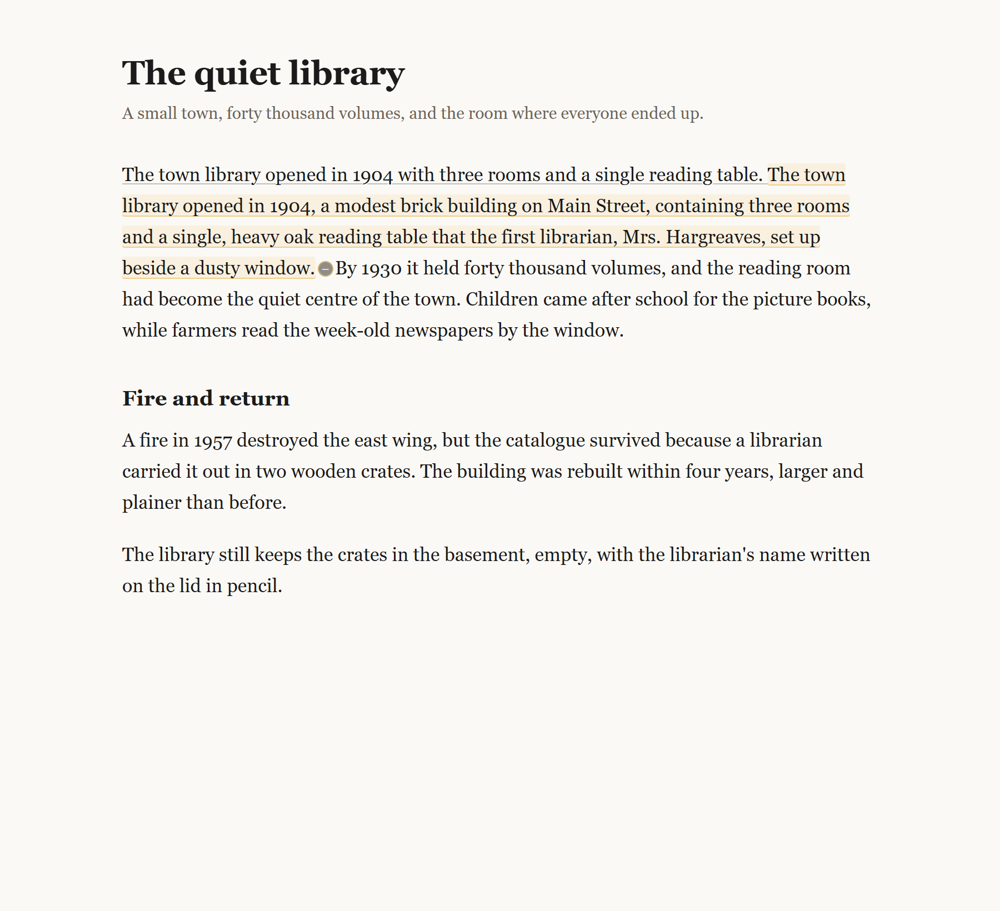

# Stretch — stretchtext for any web page

In 1967 Ted Nelson described **stretchtext**: text that grows where the reader wants more and
shrinks back where they don't. Writing every level by hand was too much work, so it never caught
on. This extension writes those levels on demand, for whatever page you are reading.

Click a sentence and it is replaced by a longer version, with the original underlined and one
click away. Click again inside the new text and it goes deeper. Click the `−` and the page is back
exactly as it was. Shift-click a paragraph to do the opposite: collapse it into one or two
sentences that keep the meaning.



Every stretch is paid for with **your own Pollen** — no subscription, and the developer pays
nothing. The key lives in your browser.

```
click a sentence  →  3–4 lines of detail, in place
click "−"         →  original sentence, untouched
shift-click       →  the whole paragraph, condensed
Esc               →  shrink the last stretch
```

## Install

Stretch is a Manifest V3 extension for Chrome, Edge, Brave, Arc and other Chromium browsers.

### From a release (recommended)

1. Download `stretch-<version>.zip` from the releases page and unzip it.
2. Open `chrome://extensions` (or `edge://extensions`).
3. Turn on **Developer mode**.
4. Click **Load unpacked** and pick the unzipped folder.

### From source

```bash
git clone <this repo>
cd stretchtext-web
npm test          # optional: 28 checks, no dependencies
```

Then load the repository folder itself — `manifest.json` is at the top level and the bundled
content script is committed, so no build step is required.

Pin the extension to the toolbar, open any article, click the icon → **Turn on for this site**.
The setting is remembered per host; `Alt+Shift+S` toggles it from the keyboard.

## Connect your Pollen

The first stretch asks you to connect:

1. Click **Connect Pollinations** in the popup (or in Settings).
2. A window shows a device code and opens the Pollinations approval page.
3. Sign in with GitHub, approve a small budget, done.

Stretch uses the [Bring Your Own Pollen](https://github.com/pollinations/pollinations/blob/main/BRING_YOUR_OWN_POLLEN.md)
device flow, which is the recommended path for extensions:

- the browser gets a short-lived key (`sk_…`) scoped to your account and the budget you approved;
- the key is stored in `chrome.storage.local` and is never sent anywhere except
  `gen.pollinations.ai`;
- keys default to 7 days; you can revoke or shrink them any time at
  [enter.pollinations.ai](https://enter.pollinations.ai).

A stretch is a few hundred tokens. With the default model (`openai/gpt-5.4-nano`) a click costs a
fraction of a Pollen; cached repeats of the same sentence cost nothing.

## What you get

| Gesture | Result |
| --- | --- |
| Click a sentence | Grows it in place, keeping the original one click away |
| Click inside grown text | Second and third level, narrower and more specific |
| Click `−` | Shrinks that stretch back to the original wording |
| Shift-click a paragraph | Replaces it with a 1–2 sentence summary (`+` restores the full text) |
| `Esc` | Collapses the most recent stretch |
| `Alt+Shift+S` | Turns Stretch on/off for the current site |
| Popup → **Shrink page** | Removes every stretch on the page |

While reading, the sentence under the cursor is highlighted, so it is always clear what a click
will touch. The popup has three detail levels (Cozy / Normal / Nerdy), a model picker and a
per-page stretch limit.

The grown text is tinted, never bolded, and inherits the page's own typography. Original wording is
never destroyed: it stays in the DOM, underlined, and is restored with one click.

## Privacy

- No account, no analytics, no server of our own.
- Page text is sent only to Pollinations, only for the sentence you clicked (plus a short
  surrounding window), and only when you click.
- The key and the expansion cache stay in `chrome.storage.local`. Clearing the cache in Settings
  removes every stored expansion.
- The content script is inert until you enable Stretch for a site.

Permissions: `storage` (key, settings, cache), `scripting` + host access to `http(s)` pages (to
inject the reader and re-inject it on pages opened before install), network access to
`gen.pollinations.ai` / `enter.pollinations.ai`.

## How it works

```
src/
  content.src.js   reader: hit-testing, sentence ranges, in-place DOM surgery
  content.css      the visual layer (::highlight, chips, toast)
  background.js    message router, BYOP device flow, caching, model list
  lib/pollinations.js  API client: chat completions, device flow, models
  lib/prompt.js    prompts + sanitising untrusted model output
  lib/text.js      sentence splitting, range planning, hashing (unit tested)
  popup.*          per-site toggle, detail, model, page stats
  options.*        connection, defaults, enabled sites, app key, cache
  auth.*           device-flow window (code, countdown, polling)
```

Content scripts cannot use ES modules, so `src/lib/text.js` + `src/content.src.js` are inlined into
`src/content.js` by `npm run build`. The generated file is committed so the extension can be loaded
unpacked without Node; `npm test` fails when it is out of date.

Design choices worth knowing:

- Expansion happens on the real DOM via `Range.extractContents()`, so inline markup, links
  around the sentence and the page's own styles keep working.
- Clicks inside links, buttons, code blocks and editable fields are ignored on purpose: Stretch
  grows prose, it does not rewrite UI.
- Model output is treated as untrusted: it is inserted with `textContent`, stripped of markdown,
  length-capped, and rejected when it is a refusal or barely longer than the original.

## Development

```bash
npm test        # unit tests: text splitting, prompt building, manifest, bundle sync
npm run build   # rebuild src/content.js after editing content.src.js or lib/text.js
npm run icons   # regenerate assets/icon-*.png (no dependencies, plain PNG writer)
npm run package # build dist/stretch-<version>.zip for a release
```

No runtime or dev dependencies. Node 20+ is only needed for the tooling.

### Publishing a build

```bash
npm run build && npm test && npm run package
```

Upload `dist/stretch-<version>.zip` to a GitHub release. For the Chrome Web Store, zip the same
folder contents; the manifest already declares the icons, the options page and the keyboard
command.

## Limitations

- Prose only: PDFs, `<canvas>` readers, shadow-DOM components and cross-origin iframes are not
  touched.
- Sentences inside links are skipped, so navigation keeps working.
- SPA sites that re-render the article drop that page's stretches (reload and click again).
- Stretch is per host: turning it on for `nytimes.com` also covers `www.nytimes.com`.

## License

MIT. Stretchtext as an idea belongs to Ted Nelson, 1967.
